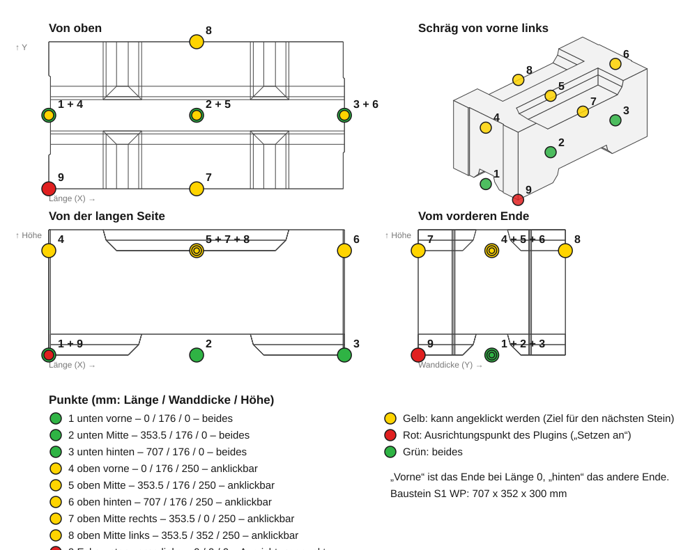

# Bedienung

Zurück zur [Übersicht](index.md).

Das Add-In hat eine Funktion: den Befehl **SYSTEM 3E Baustein**. Er setzt je Durchlauf einen Wandbaustein.

## Einen Baustein setzen

1. In Fusion eine Konstruktion öffnen.
2. Auf der Registerkarte **SOLID** im Panel **Create** auf **SYSTEM 3E Baustein** klicken.
3. **Punkt**: die Stelle für den Baustein anklicken. Anklickbar sind
   - ein Skizzenpunkt,
   - eine Ecke eines Körpers,
   - ein Konstruktionspunkt – dazu gehören die Punkte eines früher gesetzten Bausteins.

   Wird nichts angeklickt, kommt der Baustein an den Ursprung der Konstruktion. Das sagt auch die Aufforderung:
   „Punkt wählen (ohne: Ursprung)“.
4. **Gruppe**: die Gruppe der Bausteine wählen.
5. **Baustein**: den Baustein wählen. Jeder Eintrag zeigt den Namen und die Größe in mm als Länge x Breite x Höhe,
   zum Beispiel `S1 WP   707 x 352 x 300`.
6. Das Bild unter der Liste ansehen. Es zeigt den gewählten Baustein.
7. **Setzen an**: wählen, welche Stelle des Bausteins auf dem Punkt landet. Siehe unten.
8. **Drehung**: einen Winkel eingeben, wenn der Baustein gedreht werden soll.
9. **Versatz X**, **Versatz Y**, **Versatz Z**: einen Abstand eingeben, wenn der Baustein vom Punkt weggeschoben werden soll.
10. **OK** drücken.

Es geht auch umgekehrt: erst den Punkt anklicken, dann die Schaltfläche. Das Add-In übernimmt den Punkt in das Feld **Punkt**.

Solange der Dialog offen ist, zeigt Fusion den Baustein an seinem Platz als Vorschau. Endgültig entsteht er mit
**OK**.

## Gruppe und Baustein

Es gibt acht Gruppen mit 74 Bausteinen. Die Reihenfolge ist die des Herstellerkatalogs.

| Gruppe | Bausteine |
| --- | --- |
| Starter | 12 |
| Basis | 6 |
| Ergänzung | 8 |
| Sturz | 8 |
| Fensterrahmen | 6 |
| Abschluss | 12 |
| Ecke | 18 |
| Trennwand | 4 |

Beim Wechsel der Gruppe wird die Bausteinliste neu gefüllt und ihr erster Baustein ausgewählt.

Alle Bausteine mit ihrer Größe in mm (Länge x Breite x Höhe):

**Starter**

| Baustein | Größe |
| --- | --- |
| S0 200 WP | 707 x 352 x 200 |
| S0 200 W | 704 x 352 x 200 |
| S0/2 200 W | 352 x 352 x 200 |
| S0/2 200 P | 355 x 352 x 200 |
| S0 250 WP | 707 x 352 x 250 |
| S0 250 W | 704 x 352 x 250 |
| S0/2 250 W | 352 x 352 x 250 |
| S0/2 250 P | 355 x 352 x 250 |
| S0 300 WP | 707 x 352 x 300 |
| S0 300 W | 704 x 352 x 300 |
| S0/2 300 W | 352 x 352 x 300 |
| S0/2 300 P | 355 x 352 x 300 |

**Basis**

| Baustein | Größe |
| --- | --- |
| S1 WP | 707 x 352 x 300 |
| S1 W | 704 x 352 x 300 |
| S1/2 W | 352 x 352 x 300 |
| S1/2 P | 355 x 352 x 300 |
| ST W | 222 x 352 x 300 |
| ST P | 225 x 352 x 300 |

**Ergänzung**

| Baustein | Größe |
| --- | --- |
| EU 150 WP | 707 x 352 x 150 |
| EU 150 W | 704 x 352 x 150 |
| EU/2 150 W | 352 x 352 x 150 |
| EU/2 150 P | 355 x 352 x 150 |
| EU 200 WP | 707 x 352 x 200 |
| EU 200 W | 704 x 352 x 200 |
| EU/2 200 W | 352 x 352 x 200 |
| EU/2 200 P | 355 x 352 x 200 |

**Sturz**

| Baustein | Größe |
| --- | --- |
| EN WP | 707 x 352 x 170 |
| EN W | 704 x 352 x 170 |
| EN/2 W | 352 x 352 x 170 |
| EN/2 P | 355 x 352 x 170 |
| EPN WP L | 707 x 352 x 300 |
| EPN W L | 704 x 352 x 300 |
| EPN WP P | 707 x 352 x 300 |
| EPN W P | 704 x 352 x 300 |

**Fensterrahmen**

| Baustein | Größe |
| --- | --- |
| EO/2 WP L | 707 x 352 x 300 |
| EO/2 WP P | 707 x 352 x 300 |
| EO/2 W P | 704 x 352 x 300 |
| EO/2 200 WP L | 707 x 352 x 300 |
| EO/2 200 WP P | 707 x 352 x 300 |
| EO/2 200 W P | 704 x 352 x 300 |

**Abschluss**

| Baustein | Größe |
| --- | --- |
| EWN WP L | 707 x 352 x 250 |
| EWN W L | 704 x 352 x 250 |
| EWN WP P | 707 x 352 x 250 |
| EWN W P | 704 x 352 x 250 |
| SZ/EO WP | 707 x 352 x 250 |
| SZ/EO W | 704 x 352 x 250 |
| SZ/2 W | 352 x 352 x 250 |
| SZ/2 P | 355 x 352 x 250 |
| SZ/EO 200 WP | 707 x 352 x 200 |
| SZ/EO 200 W | 704 x 352 x 200 |
| SZ/2 200 W | 352 x 352 x 200 |
| SZ/2 200 P | 355 x 352 x 200 |

**Ecke**

| Baustein | Größe |
| --- | --- |
| SNL | 704 x 352 x 300 |
| SNL/2 | 352 x 352 x 300 |
| SNP | 704 x 352 x 300 |
| SNP/2 | 352 x 352 x 300 |
| ENL | 704 x 352 x 300 |
| ENP | 704 x 352 x 300 |
| SZL | 704 x 352 x 250 |
| SZP | 704 x 352 x 250 |
| EWNL | 704 x 352 x 250 |
| EWNP | 704 x 352 x 250 |
| EO/2 LT | 704 x 352 x 300 |
| EO/2 LP | 698 x 352 x 300 |
| EO/2 PT | 704 x 352 x 300 |
| EO/2 PP | 704 x 352 x 300 |
| EO/2 200 LT | 704 x 352 x 300 |
| EO/2 200 LP | 704 x 352 x 300 |
| EO/2 200 PT | 704 x 352 x 300 |
| EO/2 200 PP | 704 x 352 x 300 |

**Trennwand**

| Baustein | Größe |
| --- | --- |
| D1 115 | 704 x 115 x 250 |
| D1/2 115 | 352 x 115 x 250 |
| D1 175 | 704 x 175 x 200 |
| D1/2 175 | 352 x 175 x 200 |

Hinweise zur Liste:

- Die Größen sind die Außenmaße aus der Bausteinbibliothek, auf ganze mm gerundet.
- Die Namen sind die Katalognamen. Das Add-In übersetzt sie nicht.
- Die Links/Rechts-Namen der Eck- und Fensterbausteine wurden nach Augenmaß mit den Katalogblättern des Herstellers
  abgeglichen. Sie sind **nicht bestätigt**. Das Bild und den gesetzten Körper prüfen, bevor man sich auf den Namen verlässt.
- `S0/2 200 P` ist in der 3D-Datei des Herstellers beschädigt. Seine Form ist aus `S0/2 250 P` nachgebaut.
- Die vier Trennwand-Bausteine sind einfache Quader. Ihre Größen stammen von den Katalogblättern.

## Das Vorschaubild

- Das Bild zeigt den gewählten Baustein als grau schattierte Ansicht, von vorne links und von oben gesehen.
- Es wechselt, wenn **Gruppe** oder **Baustein** geändert wird.
- Die Bilder sind aus der Bausteinbibliothek gezeichnet. Sie stammen nicht aus dem Herstellerkatalog.

## Richtungen an einem Baustein

Diese Wörter werden für die Punkte und unter **Setzen an** benutzt.

| Wort | Bedeutung |
| --- | --- |
| vorne | das Ende des Bausteins bei Länge 0 |
| hinten | das andere Ende |
| rechts, links | vom vorderen Ende aus gesehen, mit Blick entlang der Wand |
| unten | die Unterseite |
| oben | die Höhe, auf der die nächste Schicht steht (siehe unten), oder bei den zwei oberen Ecken der höchste Punkt |

Eine Schicht ist eine Lage von Bausteinen in einer Wand.

Bei **Drehung** 0 läuft die Länge entlang der X-Achse der Konstruktion, die Wanddicke entlang Y und die Höhe
entlang Z. „Rechts“ ist dann die Seite mit dem kleineren Y-Wert.

## Die zwölf Punkte eines Bausteins

Jeder gesetzte Baustein trägt zwölf Konstruktionspunkte. Ein Konstruktionspunkt ist ein Hilfspunkt in Fusion, der sich
anklicken lässt. Die Punkte haben Namen. Die Namen stehen in der Sprache, die das Add-In benutzt hat, als der Baustein
zum ersten Mal gesetzt wurde.

| Name | Wo er liegt |
| --- | --- |
| unten vorne | Unterseite, vorderes Ende, Mitte der Wanddicke |
| unten Mitte | Unterseite, halbe Länge, Mitte der Wanddicke |
| unten hinten | Unterseite, hinteres Ende, Mitte der Wanddicke |
| oben vorne | Höhe der nächsten Schicht, vorderes Ende, Mitte der Wanddicke |
| oben Mitte | Höhe der nächsten Schicht, halbe Länge, Mitte der Wanddicke |
| oben hinten | Höhe der nächsten Schicht, hinteres Ende, Mitte der Wanddicke |
| oben Mitte rechts | Höhe der nächsten Schicht, halbe Länge, rechte Wandfläche |
| oben Mitte links | Höhe der nächsten Schicht, halbe Länge, linke Wandfläche |
| unten Mitte rechts | Unterseite, halbe Länge, rechte Wandfläche |
| unten Mitte links | Unterseite, halbe Länge, linke Wandfläche |
| Mitte rechts, 50 mm hoch | 50 mm über der Unterseite, halbe Länge, rechte Wandfläche |
| Mitte links, 50 mm hoch | 50 mm über der Unterseite, halbe Länge, linke Wandfläche |

„Höhe der nächsten Schicht“: Bausteine mit dem erhöhten Profil auf der Oberseite tragen die nächste Schicht 50 mm unter
ihrem höchsten Punkt. Flache Bausteine tragen sie obenauf. Beispiel: `S1 WP` ist 300 mm hoch, die nächste Schicht steht auf 250 mm.

Die Zeichnung zeigt alle Punkte am Basisbaustein `S1 WP`. Ihre Beschriftung ist deutsch. Gelb: lässt sich anklicken.
Rot: lässt sich unter **Setzen an** wählen. Grün: beides.

Stand: Die Punkte sind nur offline geprüft, **nicht in Fusion**.

## Setzen an

**Setzen an** legt fest, welche Stelle des neuen Bausteins auf dem angeklickten Punkt landet. Die Liste hat 15 Einträge:

| Eintrag | Stelle des Bausteins |
| --- | --- |
| Ecke unten vorne rechts | unterste Ecke am vorderen Ende, rechte Seite. Das ist die Vorgabe. |
| Ecke oben vorne rechts | höchste Ecke am vorderen Ende, rechte Seite |
| Ecke oben vorne links | höchste Ecke am vorderen Ende, linke Seite |
| unten vorne … Mitte links, 50 mm hoch | einer der zwölf Punkte aus der Tabelle oben |

Die zwei oberen Ecken nutzen die volle Höhe des Bausteins, nicht die Höhe der nächsten Schicht.

Stand: Die Auswahl unter **Setzen an** ist nur offline geprüft, **nicht in Fusion**.

## Drehung

- **Drehung** dreht den Baustein um die senkrechte Achse. Das ist die Z-Achse der Konstruktion.
- Gedreht wird um die Stelle, die unter **Setzen an** gewählt ist. Diese Stelle bleibt auf dem angeklickten Punkt.
- Der Winkel wird in Grad angegeben. Ein positiver Winkel dreht gegen den Uhrzeigersinn, von oben gesehen.

## Versatz

- **Versatz X**, **Versatz Y** und **Versatz Z** schieben den Baustein vom angeklickten Punkt weg.
- Die Werte sind in mm.
- Sie laufen entlang der Achsen der Konstruktion. Sie drehen sich nicht mit dem Baustein.
- Negative Werte schieben in die andere Richtung.

Beispiel: kein Punkt angeklickt, **Versatz Z** 300 mm. Der Baustein wird 300 mm über dem Ursprung gesetzt.

Stand: Der Versatz ist nur offline geprüft, **nicht in Fusion**.

## Eine Wand im Verband bauen

„Im Verband“ heißt: Jede Schicht ist gegenüber der Schicht darunter um einen halben Baustein versetzt.

1. Den ersten Baustein der untersten Schicht setzen. Dazu **Setzen an**: **Ecke unten vorne rechts** verwenden.
2. Den Befehl noch einmal starten. **Setzen an**: **unten vorne** wählen.
3. Den Punkt **unten hinten** des eben gesetzten Bausteins anklicken. Der nächste Baustein setzt die Schicht fort.
4. Das wiederholen, bis die erste Schicht fertig ist.
5. Für die zweite Schicht den Befehl noch einmal starten. **Setzen an**: **unten Mitte** wählen.
6. Den Punkt **oben vorne** oder **oben hinten** eines Bausteins der Schicht darunter anklicken.
   Der neue Baustein sitzt dann zur Hälfte auf diesem Baustein und zur Hälfte daneben.
7. Die zweite Schicht wie in den Schritten 2 und 3 fortsetzen.

Die Einstellungen bleiben, wie sie zuletzt waren. Es genügt also, den nächsten Punkt anzuklicken und **OK** zu drücken.

Hinweise:

- Schritt 6 ist der Weg, den die Beschreibung des Add-Ins selbst für eine Wand im Verband nennt. Die Schritte 2 bis 4
  ergeben sich aus der Lage der Punkte; sie sind **nicht in Fusion geprüft**.
- Bei Bausteinen mit einer Feder am Ende (3 mm länger, Namen enden auf `WP` oder `P`) liegen die Punkte **unten vorne** und
  **unten hinten** an den äußersten Enden. Die Fuge zwischen zwei Bausteinen in der eigenen Konstruktion prüfen.
- Das Add-In prüft nicht, ob sich Bausteine überschneiden oder ob ein Baustein an eine Stelle passt.

## Stückliste: wie gleiche Bausteine zählen

- Wird ein Baustein zum ersten Mal gesetzt, legt das Add-In eine Komponente namens `SYSTEM 3E <name>` an,
  zum Beispiel `SYSTEM 3E S1 WP`. Der Körper darin heißt wie der Baustein, zum Beispiel `S1 WP`.
- Bei jedem weiteren Setzen desselben Bausteins in dieser Konstruktion fügt das Add-In eine weitere Kopie derselben
  Komponente ein. Es legt keine neue Komponente an.
- Eine Stückliste zeigt deshalb eine Zeile für den Baustein mit seiner Anzahl, nicht `S1 WP`, `S1 WP (1)`, `S1 WP (2)`.
- Die Komponente darf umbenannt werden. Das Add-In findet sie trotzdem, weil es eine unsichtbare Markierung an ihr hinterlässt.
- Weil die Kopien sich eine Komponente teilen, ändert eine Änderung am Körper einer Kopie alle Kopien.
- Alle Bausteine entstehen direkt in der obersten Ebene der Konstruktion (der Stammkomponente).
